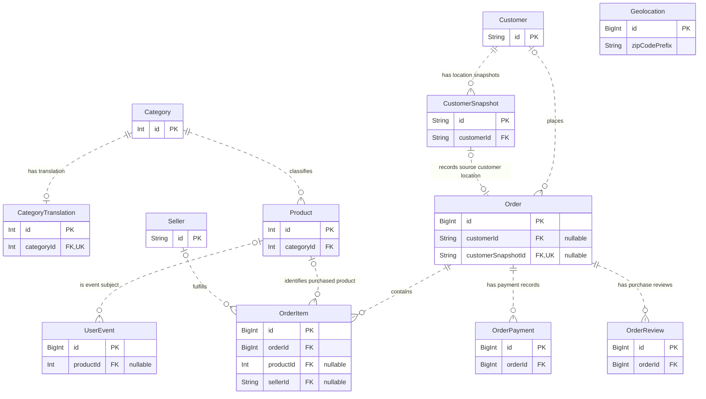
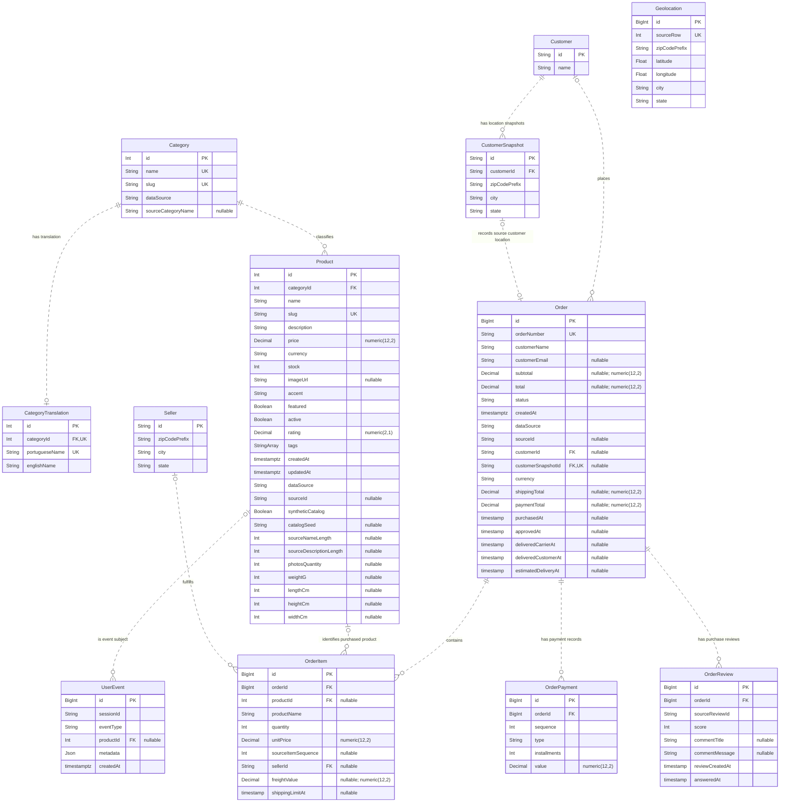

# Current data model

This document describes all **12 Prisma entities** and their **11 foreign-key relationships** in
[`server/prisma/schema.prisma`](../server/prisma/schema.prisma), including the Olist extensions.
It documents the code-defined model; it does not inspect which migrations a particular running
PostgreSQL database has applied. Entity and field names below match Prisma. The table mapping is
listed after the diagrams.

## Relationship overview

The overview shows primary keys and foreign keys. Geolocation's ZIP prefix is also shown to
make its optional enrichment role visible. The complete diagram below includes every stored field.

## Reading the diagrams

- `PK`: primary key; `FK`: foreign key; `UK`: individually unique field.
- `||`: exactly one; `o|`: zero or one; `o{`: zero or many. Read the symbol next to an entity
  as the number of that entity allowed for one record on the opposite side.
- Dashed lines are actual, non-identifying foreign-key relationships: each child has its own
  independent primary key. They do not represent inferred ZIP-code joins.
- `nullable` means the stored column can be null. Relationship navigation fields such as
  `Product.orderItems` are represented by the lines rather than duplicated as stored columns.
- `StringArray` is Prisma `String[]`. Source lifecycle/review/deadline fields use PostgreSQL
  `TIMESTAMP`; native record timestamps use `TIMESTAMPTZ`. Decimal precision is shown where relevant.
- Composite unique keys are listed separately; their individual components are not marked `UK`.

## Complete entity and field diagram

## Entity-to-table mapping

| Prisma entity | PostgreSQL table | Purpose |
| --- | --- | --- |
| `Category` | `categories` | Catalog classification, including original Olist category codes. |
| `CategoryTranslation` | `category_translations` | Original Portuguese-to-English category mapping; optional one-to-one translation per category. |
| `Customer` | `customers` | Persistent customer identity; imported name equals its source unique customer ID. |
| `CustomerSnapshot` | `customer_snapshots` | Order-specific source customer ID and delivery-location snapshot. |
| `Seller` | `sellers` | Seller identity and location; attached to individual purchased items. |
| `Geolocation` | `geolocations` | ZIP-prefix coordinate observations, including repeated prefixes and duplicate observations. |
| `Product` | `products` | Storefront catalog, generated-field provenance, and original physical/text-length metadata. |
| `Order` | `orders` | Customer references, monetary aggregates, status, provenance, and delivery lifecycle. |
| `OrderItem` | `order_items` | Purchased product/name/price snapshot, quantity, seller, freight, and shipping deadline. |
| `OrderPayment` | `order_payments` | Payment sequence, method, installments, and value; an order can have several. |
| `OrderReview` | `order_reviews` | Purchase-experience review, score, optional comments, and source dates. |
| `UserEvent` | `user_events` | Session interaction log with optional product and JSON metadata. |

## Composite unique keys

These enforce uniqueness of a combination of fields, not each field separately.

| Entity | Unique field combination |
| --- | --- |
| `Category` | `dataSource`, `sourceCategoryName` |
| `Product` | `dataSource`, `sourceId` |
| `Order` | `dataSource`, `sourceId` |
| `OrderItem` | `orderId`, `sourceItemSequence` |
| `OrderPayment` | `orderId`, `sequence` |
| `OrderReview` | `orderId`, `sourceReviewId` |

## Relationship details worth reviewing

- A category has zero or one translation; every translation belongs to exactly one category.
- Every product belongs to a category. Product references on historical order items and user
  events are nullable, so those records can exist without a product association.
- Every customer snapshot belongs to a persistent customer. An order's persistent customer and
  snapshot references are independently optional; a snapshot can be linked to at most one order.
  The schema does not enforce that `Order.customerId` equals the referenced snapshot's
  `customerId`; import logic supplies matching values.
- Every order item belongs to an order. Seller references are optional for native/demo checkout.
  Orders can contain items from multiple sellers; there is no single order-level seller relation.
- Order items, payments, and reviews are separate one-to-many children. The schema allows an order
  without any of them, accommodating itemless source orders and native demo orders without payment records.
- External review IDs are unique only together with their order, not across the entire review table.
- Deleting an order cascades to its items, payments, and reviews. Other foreign keys use `NoAction`
  for deletion; all modeled foreign keys use `NoAction` for updates.
- **Geolocation has no foreign-key relationships.** Its ZIP prefix is not unique. Customer snapshots
  and sellers can be enriched by matching ZIP prefixes, but raw observations must first be reduced
  to the intended lookup grain to avoid multiplying joined rows. Missing prefixes remain valid.

Indexes and defaults remain documented in the Prisma schema and the Flyway migration files.
When the model changes, update both diagrams and the composite-key table in this document.
