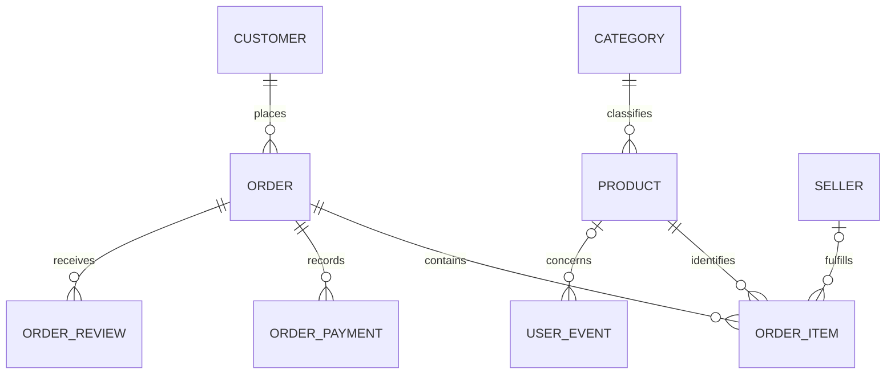

# Olist dataset and Signal Shop: data-model fit assessment

Date: 10 October 2026. Status: original assessment written before implementation. The subsequently approved data models, synthetic catalog policy and import migrations are documented in [`OLIST_IMPLEMENTATION.md`](./OLIST_IMPLEMENTATION.md). Recommendations below retain the original review context.

## Recommendation

Use Olist as a historical marketplace dataset inside an expanded Signal Shop model. Keep the existing product, category, order, order-item, and event concepts. Add customers, sellers, order payments, and order reviews; extend existing tables with source identifiers, provenance, delivery fields, shipping charges, and nullable catalog attributes. Geolocation can remain in the source CSVs initially, with a separate optional enrichment layer.

This is a manageable expansion of the data model. It does not require building seller administration, real payment processing, authentication, or a full marketplace application. However, it also requires targeted changes to catalog display, checkout eligibility, analytics, and the planned ML extraction. Importing the CSVs into the current five tables without these changes would lose information or invent facts.

Two limits cannot be fixed by schema changes: Olist does not provide actual product titles/descriptions, and its baskets contain very little co-purchasing. It helps replace the tiny demonstration purchase dataset, but it does not provide the rich product-text corpus assumed in the current word-embedding plan.

## 1. What was inspected

- All nine local CSVs, using a CSV parser that handles quoted commas and embedded newlines. Counts below are parsed records, not physical line counts.
- `server/prisma/schema.prisma` and Flyway migrations V1–V3.
- Product, order, category, event, recommendation, and admin code; product mapping and validation; client catalog, cart, product details, and admin behavior.
- `README.md`, `docs/ARCHITECTURE.md`, `docs/ML_STACK.md`, workspace scripts, and `docker-compose.yml`.
- The publisher's [Kaggle data card](https://www.kaggle.com/olistbr/brazilian-ecommerce/home/) and [customer documentation](https://www.kaggle.com/olistbr/brazilian-ecommerce/metadata), for the dataset's marketplace context and customer-identifier semantics.

All numerical findings come from the local files. The accompanying `OLIST_DATA_PROFILE.json` records counts, missingness, key checks, reconciliation, and basket statistics. This assessment compares files with repository code; it does not assert the state of a running database.

The publisher describes anonymized commercial orders across multiple marketplaces. It also describes reviews as purchase-experience surveys, which is why reviews should be modeled at order level rather than automatically treated as product ratings. [Source](https://www.kaggle.com/olistbr/brazilian-ecommerce/home/)

## 2. Dataset inventory and actual relationships

| Local CSV | Records | Grain / identity | Main information |
| --- | ---: | --- | --- |
| `olist_customers_dataset.csv` | 99,441 | One order-specific customer record, unique `customer_id` | Persistent customer identifier and delivery location |
| `olist_orders_dataset.csv` | 99,441 | One order, unique `order_id` | Status and purchase/approval/shipping/delivery dates |
| `olist_order_items_dataset.csv` | 112,650 | One purchased unit, unique `(order_id, order_item_id)` | Product, seller, item price, freight, shipping deadline |
| `olist_products_dataset.csv` | 32,951 | One product, unique `product_id` | Category, text lengths, photo count, weight and dimensions |
| `olist_sellers_dataset.csv` | 3,095 | One seller, unique `seller_id` | Seller location |
| `olist_order_payments_dataset.csv` | 103,886 | One payment record, unique `(order_id, payment_sequential)` | Type, installment count and payment value |
| `olist_order_reviews_dataset.csv` | 99,224 | One review/order association, unique `(review_id, order_id)` in these files | Score, optional comments and review dates |
| `olist_geolocation_dataset.csv` | 1,000,163 | A location observation; ZIP prefix is not unique | Coordinates, city and state |
| `product_category_name_translation.csv` | 71 | One category translation, unique Portuguese name | English category label |

Relationships in the source:

```text
customer_unique_id identifies a person across orders
    -> customer_id identifies an order-specific customer/location record
        -> order_id
            -> order items -> products -> category translation
                          -> sellers
            -> payment records
            -> review associations

Customer and seller ZIP prefixes can be enriched with geolocation observations.
```

All checked order/customer, item/order, item/product, item/seller, payment/order, and review/order foreign-key references resolve in the local files. This is good evidence for a relational import, but child tables are not present for every order.

Orders range from **2016-09-04 21:15:19** to **2018-10-17 17:30:18** by purchase timestamp. These timestamps contain no timezone offset. The files do not encode a currency column either; assigning `BRL` should be an explicit dataset configuration assumption, with amounts preserved and no currency conversion.

## 3. Current system model

The current system has five tables:

- `categories`: display name and slug.
- `products`: category, required name/description/price/stock/rating, display attributes, tags, availability flag and record timestamps.
- `orders`: required customer name/email, subtotal, total, status and creation timestamp.
- `order_items`: product reference, product-name snapshot, quantity and unit-price snapshot.
- `user_events`: browser session, event type, optional product, metadata and timestamp.

The model works for a small electronics shop. Checkout merges repeated product IDs, uses the current catalog price, checks and decrements inventory, creates a `paid` order, and makes subtotal equal total. Admin customer counts use distinct emails. The recommendation endpoint is still a category/featured/rating placeholder, not a trained model.

The committed demonstration migration contains five categories, nine products, and three two-product orders. The larger ML architecture and pipeline described in the documentation are planned work rather than implemented training components.

## 4. Gaps and consequences

| Area | Current assumption | What Olist actually supplies | Required decision/change |
| --- | --- | --- | --- |
| IDs | Integer product/category IDs; integer order IDs exposed to client | 32-character external IDs for products, orders, customers and sellers | Retain internal IDs and add unique source-qualified external IDs; maintain deterministic mappings |
| Customers | Name and email repeated on each order | Anonymous IDs and location; no names/emails | Add persistent customer identity, make imported contact snapshots nullable, preserve per-order location |
| Product text | Product name and description are real text | Only `product_name_lenght` and `product_description_lenght` numbers | Generated display labels must be marked as generated; no real text can be recovered from lengths |
| Price | One current price on the product | Historical price on each purchased unit | Preserve line prices; current catalog price may be unknown; label any historical reference price as derived |
| Inventory | Known stock count required for checkout | No inventory or current availability | Unknown stock must remain unknown; historical products should be browsable but not automatically purchasable |
| Categories | Five electronics categories | 73 nonempty source categories, mostly beyond electronics | Import source categories separately and retain Portuguese codes plus optional English labels |
| Product attributes | No physical or source-text metadata | Weight, dimensions, photo count, title/description lengths | Add nullable metadata fields; a photo count is not an image URL |
| Sellers | No seller concept | Seller per order item; orders can involve multiple sellers | Add seller relation to order items; avoid assuming a single seller per order |
| Items | Product-level quantity, one catalog price per checkout | One row per purchased unit, possibly different sellers/prices/freight/deadlines | Import one row as quantity 1; keep source sequence; aggregate only for downstream views |
| Shipping | No freight field | Freight per unit and shipping deadline | Add line freight/deadline; derive order shipping total from lines when present |
| Lifecycle | `paid`, creation time | Eight statuses and five source date fields | Preserve source statuses and nullable lifecycle dates; define explicit success predicates |
| Payments | No payment table; order total represents checkout amount | Multiple payment records, installment metadata, occasional mismatches | Add one-to-many payment records; keep payment totals distinct from item-plus-freight totals |
| Reviews | A scalar product rating defaulting to 4.5 | Order-experience scores/comments, sometimes multiple reviews | Add order reviews; imported product rating should be unknown unless a separately labeled proxy is introduced |
| Geography | No address or coordinates | ZIP prefixes and location observations | Store locations as snapshots; optional left-join enrichment after reducing geolocation to the intended grain |
| Events | Views/search/cart/recommendation clicks | No browsing or recommendation exposure data | Keep collecting new events; do not generate historic clicks or CTR denominators from purchases |
| Provenance | Seed/native data share one model | Real historical records alongside synthetic demo data | Distinguish demo, native and Olist origins; filter training and analytics deliberately |

### Customer identity must be modeled at the right level

There are **96,096 persistent `customer_unique_id` values** in 99,441 customer rows. Exactly 2,997 persistent customers have multiple orders; the maximum is 17. No `customer_id` is reused by orders in these files.

The publisher confirms that `customer_id` is assigned per order and `customer_unique_id` connects repurchases. [Source](https://www.kaggle.com/olistbr/brazilian-ecommerce/metadata)

Recommended mapping: create one `Customer` per source-qualified `customer_unique_id`; put its internal FK on the order. Also preserve the source `customer_id` and ZIP/city/state on that order. This keeps historical addresses when the same customer has different locations, without adding a separate address-management subsystem. No fake names or email addresses are necessary. Native checkout can continue validating name/email for new orders.

### Historical price is not a current offer

**5,900 products have more than one observed historical price**, and **1,225 products were sold by multiple sellers**. **1,278 orders contain multiple sellers**. A simple `product.price = first CSV price` assignment is arbitrary, and grouping solely by `(order, product)` can erase seller and price information.

Preserve source lines as purchased units with `quantity = 1`. Do not replay those lines through checkout: that would reprice them, require names/emails, mark them paid now, and decrement current inventory.

If the demo later needs purchasable examples, explicitly curate a small subset with simulated inventory and a chosen price. Keep those overrides distinct from observed source facts. This is a separate presentation/demo decision from importing purchase history.

## 5. Recommended modest expansion

Four new domain tables are sufficient for the core historical model. Keep geolocation optional.



Native orders can have a nullable customer FK during the transition; native order items can have no seller. Existing demo checkout does not require a seller workflow or real payment records.

| Entity | Proposed additions or changes |
| --- | --- |
| `Customer` — new | Internal ID; source; external persistent customer ID; uniqueness on `(source, external_id)`. Imported identity is anonymous; no required name/email. |
| `Seller` — new | Internal ID; source; external seller ID; ZIP prefix, city, state; uniqueness on `(source, external_id)`. No seller name is supplied. |
| `Category` — extend | Source category code and optional English translation, with source-qualified code uniqueness. Preserve current display name/slug and choose collision-safe slugs. Use a distinct unknown-category record for 610 uncategorized products. |
| `Product` — extend | Source/external ID; generated-label provenance; nullable description/current price/stock/rating for imported records; explicit checkout eligibility. Nullable name length, description length, photo count, weight in grams, length/height/width in cm. Retain internal IDs, name/slug, tags and display attributes. |
| `Order` — extend | Source/external ID; nullable customer FK; source order-specific customer ID; location snapshot; nullable name/email snapshots; source lifecycle dates; currency; shipping total and payment total; preservation of source status. Make subtotal/total nullable when item detail is unavailable. |
| `OrderItem` — extend | Optional seller FK, source item sequence, freight amount, shipping-limit date. Preserve product/name/price snapshot and quantity; add unique `(order_id, source_item_sequence)` for imported rows. Native sequence can be nullable. |
| `OrderPayment` — new | Internal ID; order FK; payment sequence, type, installments, value; unique `(order_id, payment_sequence)`. |
| `OrderReview` — new | Internal ID; order FK; external review ID; score, nullable comment title/message; creation and answer dates; unique `(order_id, external_review_id)` for this source. Do not make external review ID globally unique. |
| `UserEvent` — retain | Continue logging actual Signal Shop events. No historic Olist session or click data exists to fill this table. |
| Geolocation — optional | Preserve raw observations in a staging table or the CSVs; publish one explicitly derived location per prefix for enrichment. Neither coordinates nor a prefix FK should be required for customers/sellers. |

Use explicit source/origin values such as `demo`, `signal_shop`, and `olist`. Product/category/customer/seller/order mappings must use those namespaces so imports cannot collide with native records. Derived display text and prices need their own provenance; a row being from Olist does not make its generated label an observed Olist title.

For product labels, use a readable category plus the complete external product identifier, or another deterministic unique suffix. An abbreviated ID alone must not be assumed unique. Generated text is suitable for displaying anonymous catalog entries, but must not be included in embedding experiments as if it were authentic product copy.

For timestamps, preserve the original timezone-free source values. Define whether normalized application timestamps assume a source timezone before implementation, and document that assumption. Native record-creation time, source purchase time, and import time are different concepts. ML splitting and historical analytics must use purchase time, never import time.

For order amounts, the proposed semantics are:

```text
subtotal       = sum(item.price * quantity)
shipping_total = sum(item.freight_value)
total          = subtotal + shipping_total
payment_total  = sum(payment.payment_value)
```

These are operational aggregates, not claims about accounting recognition. Preserve disagreements between `total` and `payment_total`. If an order has no items, subtotal/shipping/total are unknown rather than zero; payment records can still be retained. Native checkout can still write known amounts with zero shipping and no actual payment transaction.

Do not add a strict equality constraint between order totals and payments, a mandatory review/payment relation, or a mandatory customer/seller-to-geolocation FK.

## 6. Complete source-field mapping

| Source file / columns | Proposed destination or treatment |
| --- | --- |
| Customers: `customer_id` | Order's source customer-record ID |
| Customers: `customer_unique_id` | Customer's source-qualified external persistent ID |
| Customers: `customer_zip_code_prefix`, `customer_city`, `customer_state` | Order location snapshot; preserve ZIP as a five-character string, including leading zeroes |
| Orders: `order_id`, `customer_id` | Source order ID and customer-record lookup to persistent customer FK/location snapshot |
| Orders: `order_status` | Preserve source status, with explicit derived success predicate |
| Orders: `order_purchase_timestamp`, `order_approved_at`, `order_delivered_carrier_date`, `order_delivered_customer_date`, `order_estimated_delivery_date` | Purchase, approval, carrier delivery, customer delivery and estimated delivery timestamps; nullable where missing |
| Items: `order_id`, `order_item_id`, `product_id`, `seller_id` | Internal order/product/seller mappings plus source line sequence |
| Items: `shipping_limit_date`, `price`, `freight_value` | Line deadline, unit-price snapshot and per-unit freight; quantity 1 |
| Products: `product_id`, `product_category_name` | Source product ID and source category lookup |
| Products: `product_name_lenght`, `product_description_lenght`, `product_photos_qty` | Nullable numeric metadata; normalize spelling in application names |
| Products: `product_weight_g`, `product_length_cm`, `product_height_cm`, `product_width_cm` | Nullable physical metadata with units preserved |
| Sellers: `seller_id`, `seller_zip_code_prefix`, `seller_city`, `seller_state` | Seller source ID and location fields |
| Payments: `order_id`, `payment_sequential`, `payment_type`, `payment_installments`, `payment_value` | Order-payment FK, sequence, type, installments and value; installments do not multiply payment value |
| Reviews: `review_id`, `order_id`, `review_score`, `review_comment_title`, `review_comment_message`, `review_creation_date`, `review_answer_timestamp` | Order-review association and corresponding score/text/timestamps |
| Geolocation: `geolocation_zip_code_prefix`, `geolocation_lat`, `geolocation_lng`, `geolocation_city`, `geolocation_state` | Raw optional enrichment observations; retain source observations before deduplication/aggregation |
| Translation: `product_category_name`, `product_category_name_english` | Category's source code and optional English label |

Values absent from the source include customer/seller names and emails; authentic product titles/descriptions/tags; image URLs; current price, stock and active listing status; product-specific ratings; browse sessions and recommendation impressions. Any later values for these must be nullable, generated, derived, curated, or collected anew with clear provenance.

## 7. Data-quality rules the import must accommodate

| Observed issue | Local result | Import treatment |
| --- | ---: | --- |
| Orders without items | 775 | Preserve order, status, payment and review records; no invented basket or zero subtotal |
| Orders without payments | 1 | Payment relation optional |
| Orders without reviews | 768 | Review relation optional |
| Multiple payments per order | 2,961 orders; maximum 29 records | One-to-many table; do not overwrite earlier payments |
| Payment edge values | 9 zero-valued rows; installments range 0–24; 3 `not_defined` types | Allow observed zero values and unknown type; avoid a strict positive-installment constraint |
| Multiple reviews per order | 547 orders | One-to-many relation |
| Reused review ID across orders | 789 review IDs | Internal surrogate ID plus unique order/review pair, not external review-ID PK |
| Missing product category/text lengths/photo count | 610 products | Unknown category; nullable metadata |
| Missing weight/dimensions | 2 products | Nullable physical metadata; observed zero weight must not fail a strictly-positive check |
| Missing English translation | 2 category codes covering 13 products | Retain Portuguese code as display fallback |
| Missing lifecycle dates | Approval 160; carrier delivery 1,783; customer delivery 2,965 | Nullable dates; missing delivery is not automatically cancellation |
| Delivered orders missing customer-delivery date | 8 | Preserve source status and flag incomplete date; do not reject automatically |
| Missing review title/message | 87,656 / 58,247 | Blank becomes null; preserve rows and scores |
| Exact duplicate geolocation observations | 261,831 | Explicit optional deduplication; duplicates are not extra customers or orders |
| Geolocation prefix cardinality | 19,015 prefixes; 17,972 have multiple rows | Never join raw geolocation directly into order/item aggregates |
| Prefix has differing city/state labels | 8,559 prefixes | Choose/document representative-label policy rather than assume a single canonical label |
| Location prefix absent from geolocation | 278 customer rows and 7 seller rows | Left-join optional enrichment; keep unmatched locations |

Missing category translations are `pc_gamer` and `portateis_cozinha_e_preparadores_de_alimentos`. There are 73 nonempty product category codes against 71 translation rows. Including an unknown bucket means 74 Olist category records if importing all categories this way.

Geolocation coordinate bounds also include observations far outside Brazil: latitude ranges from -36.6054 to 45.0659 and longitude from -101.4668 to 121.1054. Values satisfy global latitude/longitude bounds, but are not all plausible Brazilian locations. Any mapping experiment needs a documented outlier policy; a simple average is not automatically a trustworthy location.

### Financial reconciliation

Of **98,665 orders with both items and payments**, 98,089 match exactly in integer cents. **576 differ**, of which 273 differ by one cent; the largest absolute difference is **182.81 currency units**. These are observed differences, not evidence of a particular fee, tax, discount, or source bug.

Across all source rows, item prices sum to 13,591,643.70, freight to 2,251,909.54, and payment values to 16,008,872.12. Those populations differ because some orders lack items. Do not infer a missing tax amount from the discrepancy, overwrite one sum with another, or compare whole-file sums as if they covered identical orders.

Aggregate payments, reviews and items separately at order grain before combining them. Joining all three child tables directly produces multiplication of rows and inflated sales.

## 8. Current code that would misbehave after a naive import

1. **Customer and catalog validation.** Required names/emails, descriptions, prices and inventory cannot accept honest missing source values. Import should bypass interactive checkout/product-create paths, while native forms can retain their required inputs. DTOs and mappers need nullable imported-field support.
2. **Checkout and inventory.** Historical imports must not decrement stock. A checkout-eligibility check should prevent purchase of imported history without explicitly configured demo offers. Active/browsable and purchasable are separate decisions.
3. **Cancellation filter.** `admin.repository.ts` excludes `cancelled`; Olist supplies `canceled` (625 orders). It also supplies 609 `unavailable` orders. The current broad exclusion would count source cancellations and unfinished orders. Preserve source statuses and select the intended successful population explicitly, e.g. Olist `delivered` for completed-sales and training views. Native `paid` is a demo checkout status, not equivalent to historical delivery.
4. **Inconsistent analytics populations.** Category/top-product calculations currently read all order items without an order-status filter, even though summary totals exclude a status. Both need the same chosen status/source/date/currency filters.
5. **Customer totals.** Distinct email counting fails for anonymous imports; use persistent source-qualified customer identity. Native customer/email deduplication requires an explicit fallback rather than counting all null emails as one person.
6. **Historical dates.** The dashboard's seven-day window is based on today. Olist contributes nothing to that window in 2026. Add a selectable historical period or dataset end-date view; retain original purchase dates.
7. **Currency and shipping.** The UI hardcodes `$`; line/category revenue represents merchandise while order total includes shipping under the proposal. Display currency explicitly and distinguish merchandise sales, shipping charges and payment receipts. Do not sum source and native currencies without a conversion policy.
8. **Catalog scale.** Product APIs, admin catalog and recommendation placeholder fetch all active products; the client renders/filter/sorts them locally. A 32,951-product import calls for API pagination, server-side search/filter/sort and a bounded recommendation query. Category tabs and electronics-only icon/copy also need modest generalization, or the full history must be separated from a curated demo catalog.
9. **Rating presentation.** Product cards/details and the placeholder sorter assume numeric ratings. Imported products should show an unknown/unrated state; order-experience reviews should not silently feed that field.
10. **Documented ML contract.** `ML_STACK.md` assumes rich product text, `min_support=0.01`, and exclusion of `cancelled` rather than a source-aware success filter. Its future migration numbers also assume synthetic baskets. Revise this plan after approving the dataset scope, before implementing training.

## 9. Fit to the Intelligent Systems work

### Association Rule Mining: usable, but much sparser than expected

Delivered orders are a reasonable explicit population for an initial completed-purchase experiment. All **96,478 delivered orders have item rows**.

| Delivered-order basket statistic | Result |
| --- | ---: |
| One distinct product | 93,281 orders |
| Two or more distinct products | 3,197 orders — 3.31% |
| Multiple source units but only one distinct product | 6,438 orders |
| Maximum distinct products in a basket | 8 |
| Most frequent individual product | 456 baskets — 0.473% support |
| Distinct observed product pairs | 4,022 |
| Most frequent product pair | 34 baskets — 0.0352% support |
| Product pairs occurring in at least five baskets | 21 |
| Orders containing multiple categories | 780 |
| Most frequent cross-category pair | 70 baskets |

At the documented **1% minimum support**, even the most common product fails the threshold; no product-level itemsets/rules would survive in this completed-order population. Category aggregation can increase singleton support, but does not solve cross-category pair sparsity: the largest pair still occurs only 70 times.

Recommended experiment:

- Form sets of distinct product IDs by delivered order; repeated units do not become separate items or increase support.
- Retain singleton orders in the population used to calculate global support. Mining only multi-product orders defines a conditional population and must be labeled separately.
- Sweep an absolute pair-count floor, initially 5–10 supporting orders, together with confidence/lift and rule stability checks. Five baskets corresponds to approximately `0.0000518` fractional support in the full delivered population, not 1%.
- The 21 pairs with at least five occurrences are an upper bound on such pairs before time splitting, confidence/lift thresholds and stability checks; they are not 21 already-validated rules. The training slice will contain less evidence.
- Keep popularity/category/metadata fallbacks because product-level rule coverage will be low. Do not promise a strong bought-together model solely because there are about 100,000 orders.
- Consider category rules as a separately evaluated coarse experiment. If basket completion is the main demonstration, a separate richer basket dataset or clearly labeled synthetic experiments may still be useful.

### Word Embeddings: product text is missing; review NLP is a different task

The source has **40,977 nonempty review messages**, but these describe purchase experience and are attached to orders, sometimes with multiple products and sellers. They are not product descriptions. The numeric text-length columns cannot supply vocabulary.

Options for the course work:

| Approach | What it supports | Limitation |
| --- | --- | --- |
| Category labels plus physical metadata | Coarse content similarity baseline | Products in the same category share very little distinguishing text; categorical/numeric similarity may be more informative than embeddings |
| Word2Vec/FastText on review comments | A defensible word-embedding/NLP experiment on purchase-experience language | Needs language-aware processing; cannot automatically serve as product semantic similarity |
| Product-ID embeddings from baskets (Prod2Vec) | Collaborative co-occurrence embeddings | Only 3,197 delivered multi-product baskets supply cross-product contexts; expect sparse evidence and limited coverage |
| Additional dataset with authentic product copy | The original product-text similarity idea | Olist IDs do not provide a known cross-dataset join; use a separate experiment unless identity linkage is justified |
| Generated descriptions | Readable anonymous demo catalog | Synthetic text must be labeled and excluded from claims about real-data semantic performance |

If reviews are explored as product-associated text, start with an explicit single-product-order subset and still describe the resulting representation as purchase-experience text. Do not duplicate every review across every item in a multi-item order and call the score product-specific. Review timestamps must also respect the evaluation cutoff.

### Recommendation evaluation

Use a temporal split on source purchase timestamps; fit rules, popularity and behavioral embeddings using the training slice only. Derive price/rating/review features as of that cutoff where they influence ranking. Do not use final-delivery status or post-purchase reviews as information available to a purchase-time ranker without explicitly defining the retrospective evaluation setting.

For basket completion, hide one product from test baskets with at least two distinct products. Report eligible test-basket count and the excluded singleton share alongside ranking metrics and coverage. For customer personalization, only 2,997 of 96,096 persistent customers repeat (3.12%), so repeat-customer experiments have a much smaller usable population than the overall order count suggests.

Olist cannot establish recommendation CTR, add-to-cart uplift, browsing conversion or recommendation exposure: those events are absent. Evaluate historical ranking offline and collect new Signal Shop events/impressions for future online evaluation.

## 10. Import and migration approach after review

Keep Flyway as the only schema owner and update Prisma to mirror the approved DDL. Add new versioned migrations after V3; do not edit V1–V3, drop the database or erase the demo data merely to load Olist.

Recommended separation: Flyway applies schema and constraints; a versioned, explicit dataset loader imports the large CSVs into staging and merges validated rows into domain tables. Bulk dataset loading is a data pipeline, distinct from schema startup. This supports record counts, checksums, reconciliation and safe reruns without committing a million-row SQL literal file or importing automatically on every normal startup.

The current Flyway container mounts only `server/db/migrations`, not `dataset/`. A migration cannot assume the CSVs are available inside the runner/database container. Interactive `psql` commands such as `\copy` are also not ordinary SQL executed by Flyway. If data loading must be driven by a migration, design an explicit staging-load prerequisite and a controlled data-migration step; do not add an unverified file path to a migration.

Proposed load order:

1. Record dataset checksums/version and load source rows into typed staging tables, preserving raw IDs, ZIP strings, source timestamps and decimal amounts.
2. Validate uniqueness at the actual grains and check required parent references. Convert empty optional cells to null.
3. Create source categories/translations/unknown bucket, then products, persistent customers, and sellers.
4. Create orders with persistent customer FK and order-specific customer/location snapshots, preserving status and dates.
5. Create source order-item units with product/seller mappings, sequence, price, freight and deadline. Create payment and review associations independently.
6. Calculate known order aggregates; retain unknown totals for itemless orders and record payment reconciliation differences.
7. Optionally prepare geolocation enrichment separately. Keep unmatched prefixes and distinguish raw observations from representative coordinates.
8. Reconcile source/target counts and mappings, then publish explicit ML and analytics extraction views. Run an import twice to verify it does not duplicate records or decrement inventory.

Use decimal or integer-cent arithmetic for reconciliation. Maintain stable external-to-internal mappings, source-qualified uniqueness and repeatable merge rules. A rerun should preserve native/demo records and application display overrides; source facts and demo edits must have distinct ownership.

Minimum acceptance evidence:

- All 99,441 source orders, 112,650 unit lines, 32,951 products, 3,095 sellers, 103,886 payment records and 99,224 review associations accounted for; 96,096 persistent customers after identity normalization.
- All parent references resolve; source item/payment/review association keys remain unique; itemless orders and optional relationships survive.
- Original line prices/freight, statuses, comments, and dates remain available; no invented contact information, inventory, product ratings, or browsing events.
- Cancellation/status-aware and source/currency/date-aware analytics reconcile without multiplication of child records.
- Native/demo checkout remains functional; historical products cannot be purchased without an explicit offer/inventory decision.
- Catalog browsing remains usable at the imported scale, and ML extraction reproduces the basket statistics in this report.

## 11. Decisions to settle during review

My preferred scope is **full historical import, the four core new tables, optional geolocation later, and historical catalog browsing with a small curated demo catalog for checkout**. This preserves data for the course without building a full marketplace.

The implementation scope depends on these decisions:

1. Should Signal Shop's public catalog become a general marketplace, or should all source history be available to ML/admin while only a curated subset appears in the shopping demo? All-electronics filtering would reduce the already-small co-purchase population and needs its own measured subset.
2. Should the word-embedding deliverable focus on review NLP, sparse item embeddings, or an additional authentic product-text dataset? Importing Olist does not decide this for us.
3. Should imported products remain historical/unpurchasable, or should we create clearly labeled simulated offers for a small demo subset?
4. Is separate bulk loading acceptable alongside Flyway schema migrations? This is the recommended route for the dataset size and the current container configuration.

These are review decisions, not prerequisites for completing this analysis. No model or import implementation has started.
